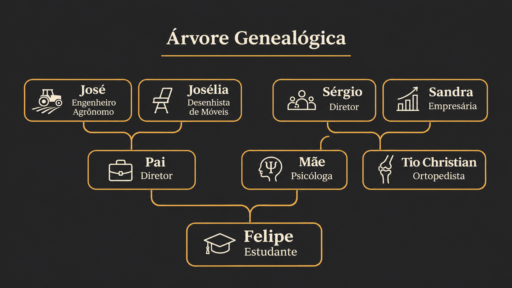

# Portfólio de Felipe Rezende Baroncelli

Portfólio escolar do curso Técnico em Informática para Internet do SENAI. Reúne minha apresentação pessoal e as atividades do curso em um Game Boy interativo.

[Acessar o portfólio](https://felipe-rbaroncelli.github.io/portfolio/)

## Entregas no Game Boy

A tabela segue a ordem atual de navegação. Os números identificam as atividades.

| Atividade | Conteúdo | Situação no site |
| --- | --- | --- |
| 01 — Capa do Meu Álbum | Álbum interativo “Camada por camada”, com capa, textos e ilustrações | Álbum acessível pelo botão START. Dados da entrega ainda marcados como “Em breve” |
| 02 — Dashboard Quem Sou Eu | Espaço reservado para a atividade | Em breve |
| 04 — Âncoras de Carreira | Espaço reservado para a atividade | Em breve |
| 05 — Manifesto | Espaço reservado para a atividade e seção no portfólio | Em breve |
| 07 — Mundo SENAI 2026 | Registro da apresentação da maquete de casa inteligente | Concluída |
| 03 — Árvore das Profissões 2.0 | Árvore genealógica com profissões e locais de trabalho | Concluída |

[Abrir Mundo SENAI no Game Boy](https://felipe-rbaroncelli.github.io/portfolio/#mundo-senai)

[Abrir a árvore no Game Boy](https://felipe-rbaroncelli.github.io/portfolio/#arvore-genealogica)

## Como navegar

- Use as setas do console, L/R ou as setas do teclado para mudar de entrega.
- Na entrega 01, START abre o álbum. Dentro dele, A avança, B volta e START sai. Na capa, SELECT mostra a explicação dos elementos.
- Nas entregas concluídas, A abre o material vinculado.
- No Mundo SENAI, use o botão de acesso para abrir a página da atividade. O botão “Voltar ao portfólio” retorna à entrega.
- Na árvore, clique na imagem ou em “Ampliar imagem” para ler os detalhes.
- O botão de tema alterna entre as versões clara e escura.

## Mundo SENAI 2026

Apresentei a maquete de casa inteligente e expliquei o LED da casa, o varal automático e a ventilação. O público incluiu alunos do 9º ano de escolas públicas, familiares e instrutores. Aprendi sobre sistemas embarcados, Internet das Coisas (IoT) e trabalho em equipe.

Muitos visitantes gostaram da inovação da maquete. Para uma próxima apresentação, quero aumentar a interação do público com os controles.

[Ver a página da atividade](https://felipe-rbaroncelli.github.io/mundo-senai-2026/)

[Ver o repositório da atividade](https://github.com/Felipe-rbaroncelli/mundo-senai-2026)

## Árvore das Profissões 2.0

A árvore aparece imediatamente depois do Mundo SENAI no Game Boy. A imagem reúne as profissões da família e inclui estas informações de atuação profissional.

| Pessoa | Profissão ou atuação |
| --- | --- |
| José | Engenheiro agrônomo, trabalhava no IMA |
| Josélia | Desenhista de móveis |
| Sérgio | Diretor, trabalhava na CBC |
| Sandra | Empresária, dona de uma livraria |
| Pai | Diretor do SESI |
| Mãe | Psicóloga |
| Tio Christian | Ortopedista |
| Felipe | Estudante |

## Arquivos e tecnologias

| Arquivo | Finalidade |
| --- | --- |
| [index.html](index.html) | Estrutura da página, estilos CSS e interações JavaScript |
| [assets/arvore-genealogica.png](assets/arvore-genealogica.png) | Imagem exibida na entrega 03 |
| [README.md](README.md) | Apresentação e instruções do repositório |

O projeto usa HTML, CSS e JavaScript. As fontes Space Grotesk, Inter e Press Start 2P são carregadas pelo Google Fonts. As imagens do Mundo SENAI são carregadas a partir do site da atividade.

Para visualizar localmente, baixe os arquivos mantendo a pasta `assets/` junto ao `index.html` e abra esse HTML no navegador. O acesso às fontes e aos materiais externos depende de conexão com a internet.

## Processo e uso de IA

As alterações foram feitas com apoio de IA na programação, na organização dos registros e na criação e edição da imagem da árvore. As informações sobre a apresentação e a família foram fornecidas por Felipe.
